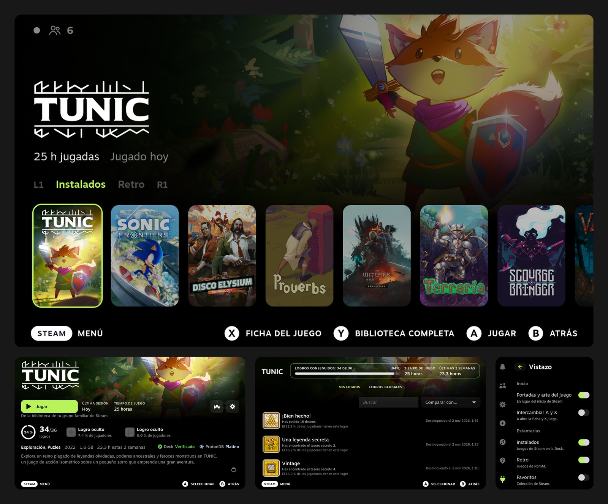

# Vistazo

**Una Steam Deck más tranquila.** Vistazo es un plugin de [Decky Loader](https://decky.xyz) que rediseña el
inicio y la ficha de cada juego pensando en la pantalla OLED, y cambia los sonidos de los menús por otros más
suaves.



- **Negro real** donde no hay nada que mostrar, que en una OLED son píxeles apagados.
- **Sin cajas, bordes, brillos ni desenfoques.** La jerarquía sale del brillo y el tamaño.
- **Un solo color de acento**, lima, y solo para lo seleccionado o enfocado.
- **En español o en inglés**, según el idioma de Steam.

## Qué cambia

### Inicio

El arte del juego enfocado llena la pantalla y se funde a negro, con su logo, las horas jugadas y la última
partida. Debajo, una fila de portadas:

- **L1 / R1** cambian de estantería: **Instalados** (juegos de Steam, del más reciente al más antiguo) y
  **Retro** (juegos de RomM que añade el plugin Tender, por última partida).
- **A** juega, **X** abre la ficha, **Y** abre la biblioteca completa. El pie de pantalla siempre lo indica.
  A y X se pueden intercambiar en los ajustes.
- **Amigos**, en la esquina superior izquierda: un punto con el color de tu estado y cuántos amigos hay
  conectados. **A** cambia tu estado; **X** abre amigos y chat.

Fuera Novedades, Amigos como pestaña y Recomendados. Al volver de un juego recuerda la estantería y la portada.

### Ficha del juego

Todo en la primera pantalla, sin cambiar de pestaña:

- **Logros**: anillo de progreso, cuántos llevas y los tres próximos (primero los que tienen progreso parcial;
  si no, los más comunes). **A** abre la lista completa.
- **Datos**: etiquetas de la tienda, año, tamaño instalado y tiempo de las últimas dos semanas.
- **Veredictos**: compatibilidad con Steam Deck con los colores de Valve y nivel de
  [ProtonDB](https://www.protondb.com) con los suyos.
- **Descripción**: tantas líneas como quepan.
- **Tus cosas** (capturas, notas, DLC), a un botón, en la esquina inferior derecha.

Los accesos directos que no son de Steam, como los juegos retro, conservan su propia ficha.

### Sonidos

Todos los sonidos de los menús (moverse, confirmar, abrir menús, interruptores, lanzar un juego, avisos) pasan
a ser tonos cortos y suaves que genera el propio plugin, sin archivos de audio. Suenan por la salida de audio
de Steam y respetan sus ajustes: volumen, dispositivo de salida y el interruptor que apaga los sonidos de la interfaz.

### Ajustes

Están en el menú de acceso rápido: **⋯ → Decky (icono del enchufe) → Vistazo**, agrupados por pantalla:

- **Inicio**: activar o desactivar el inicio, y si **A** abre la ficha y **X** lanza el juego (desactivado, al
  revés)
- **Ficha del juego**: la ficha resumida y la nota de ProtonDB (desactivada, no sale ninguna consulta de la Deck)
- **Sonido**: los sonidos tranquilos, con un botón para escuchar una muestra

Los cambios se aplican al momento y se guardan en la Deck.

## Instalar

Hace falta [Decky Loader](https://decky.xyz) en la Steam Deck.

1. En los ajustes de Decky (menú de acceso rápido → Decky → engranaje), en **General**, activa el **modo
   desarrollador**.
2. Abre **Desarrollador** → **Instalar plugin desde URL** y escribe:

   ```
   https://github.com/m4rz3r0/vistazo-decky/releases/latest/download/Vistazo.zip
   ```

   También puedes descargar `Vistazo.zip` de la [página de versiones](https://github.com/m4rz3r0/vistazo-decky/releases),
   copiarlo a la Deck y usar **Instalar plugin desde un archivo ZIP**.
3. Confirma. El nuevo inicio aparece la próxima vez que vuelvas a Inicio.

Para actualizar, repite el paso 2. Para desinstalar: Decky → engranaje → **Plugins** → **⋯** junto a Vistazo
→ **Desinstalar**. Las pantallas y los sonidos de Steam vuelven en el acto.

## Privacidad

Todo sale del cliente de Steam de la Deck, con dos excepciones:

- La nota de ProtonDB se pide a `protondb.com` solo con el número del juego, sin cuenta ni datos personales. Se
  puede desactivar.
- Las portadas que el cliente no tiene guardadas se cargan del servidor de imágenes de Steam.

No hay telemetría. Lo único que se guarda son tus ajustes, en la propia Deck.

## Compatibilidad

Luce más con un tema oscuro de CSS Loader, pero funciona solo. No toca las páginas de otros plugins; está
probado junto a Tender, CSS Loader y PlayTime. Si una actualización de Steam cambia las pantallas en las que se
apoya, Vistazo se aparta y se ve la pantalla normal de Steam.

## Compilar

```bash
pnpm install
./pack.sh        # deja out/Vistazo.zip
```

Al subir una etiqueta como `v0.7.0` (debe coincidir con `package.json`), GitHub Actions compila el plugin y
adjunta `Vistazo.zip` a una versión.

## Licencia

BSD de 3 cláusulas, ver [LICENSE](LICENSE). El archivo compilado incluye `@decky/ui` y `@decky/api`, con
licencia LGPL-2.1.

[Read in English](README.md)
