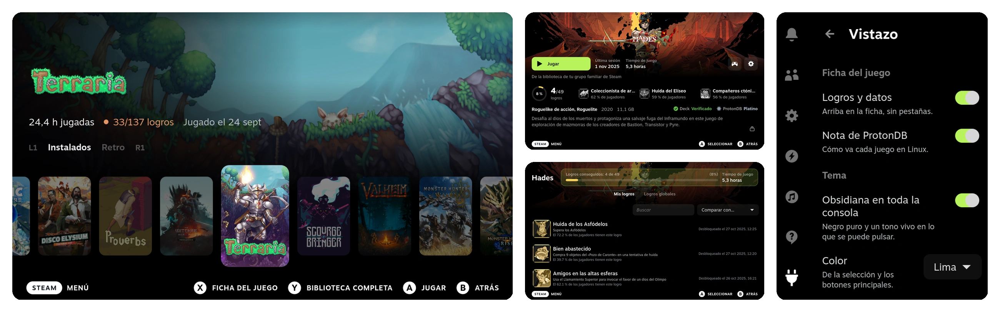

# Vistazo

**Vistazo** es un plugin de [Decky Loader](https://decky.xyz) para Steam Deck, oscuro y con criterio propio: un
inicio por estanterías, la ficha de cada juego de un vistazo y sonidos suaves.

[Read in English](README.md)



## Inicio

El juego elegido llena la pantalla con su arte. Debajo, tus juegos en estanterías: instalados, retro y
cualquiera de tus colecciones de Steam. <kbd>L1</kbd> <kbd>R1</kbd> pasan de una a otra, <kbd>A</kbd> juega, <kbd>X</kbd> abre la ficha y <kbd>Y</kbd> la biblioteca.

## Ficha

Logros, datos y los veredictos de Deck y ProtonDB en la primera pantalla, sin pestañas. <kbd>A</kbd> sobre los logros abre
la lista completa.

## Sonidos

Cada sonido de los menús pasa a ser un tono corto y suave, generado por el plugin y reproducido por la salida de
Steam.

## Ajustes

Pulsa  y abre  **Decky**, luego **Vistazo**. Activa o desactiva cada parte, intercambia <kbd>A</kbd> y <kbd>X</kbd> y elige tus
estanterías. Los cambios se aplican al momento.

## Instalar

1. Pulsa , abre  **Decky** y toca . En **General**, activa **Modo desarrollador**.
2. En **Desarrollador**, elige **Instalar plugin desde URL** y escribe:

   ```
   https://github.com/m4rz3r0/vistazo-decky/releases/latest/download/Vistazo.zip
   ```

3. Confirma. El nuevo inicio aparece la próxima vez que vuelvas a Inicio.

Para actualizar, repite el paso 2. Para quitarlo, entra en  **Plugins**.

## Privacidad

Todo sale de Steam en la Deck. La nota de ProtonDB se pide a `protondb.com` solo con el número del juego, y se
puede desactivar. Sin telemetría.

## Compilar

```bash
pnpm install && ./pack.sh    # out/Vistazo.zip
```

BSD de 3 cláusulas. El compilado incluye `@decky/ui` y `@decky/api` (LGPL-2.1).
