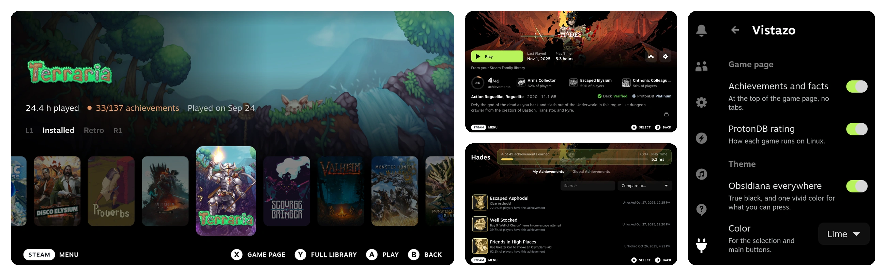

# Vistazo

**Vistazo** is a dark, opinionated [Decky Loader](https://decky.xyz) plugin for the Steam Deck: a home built on
shelves, every game page at a glance, and soft menu sounds.

[Leer en español](README.es.md)



## Home

The selected game fills the screen with its art. Your games sit below on shelves: installed, retro and any of
your Steam collections. <kbd>L1</kbd> <kbd>R1</kbd> move between them, <kbd>A</kbd> plays, <kbd>X</kbd> opens the game page and <kbd>Y</kbd> the full library.

## Game page

Achievements, facts and the Deck and ProtonDB verdicts on the first screen, no tabs. Press <kbd>A</kbd> on the
achievements for the full list.

Retro games from [RomM](https://github.com/rommapp/romm) through [Tender](https://github.com/danielcopper/romm-tender)
get the same page. To see the achievements you just earned as soon as the game closes, install the RomM add-on from
Vistazo's settings and connect it to RomM there.

## Add-ons

Vistazo is the look. What it knows beyond Steam comes from add-ons: separate Decky plugins that only those who want
them install, so nobody carries code they do not use. Vistazo's settings list them and Decky installs them, asking
first.

- **RomM** — achievements as soon as a retro game closes, and RomM games downloaded and started through RetroDECK.
- **GeForce NOW** — a button on a Steam game's page to play it in the cloud, when Nvidia's service carries it.

## Sounds

Every menu sound becomes a short, soft tone, made by the plugin and played through Steam's own output.

## Theme

Vistazo brings **Obsidiana**, a theme for the whole console: true black for the OLED screen, one vivid color
for what you can press, and motion that follows the controller. With [CSS Loader](https://deckthemes.com)
from the Decky store installed, Vistazo adds it and turns it on the first time. Pick lime, fuchsia, blue or
white, larger text and motion in Vistazo's settings. There, too, the shape of your picture in the top bar: round
(as it comes), with rounded corners, or as Steam shows it (this one works without the theme as well).

## Settings

Press , open  **Decky**, then **Vistazo**. Turn each part on or off, swap <kbd>A</kbd> and <kbd>X</kbd>, and pick your shelves. Changes
apply at once.

## Install

1. Press , open  **Decky** and select . Under **General**, turn on **Developer mode**.
2. Under **Developer**, choose **Install plugin from URL** and enter:

   ```
   https://github.com/m4rz3r0/vistazo-decky/releases/latest/download/Vistazo.zip
   ```

3. Confirm. The new home appears the next time you go Home.

To update, open Vistazo in the quick access menu and press **Update** under Version; it tells you when there is a new one. To remove it, open  **Plugins**.

## Privacy

Everything comes from Steam on the Deck. The ProtonDB rating asks `protondb.com` with the game's number only,
and can be turned off. Once a day Vistazo asks `api.github.com` whether there is a newer version, sending nothing
about you; that can be turned off too. Opening the add-ons section reads the list of add-ons from Vistazo's own
repository on GitHub. What each add-on talks to is its own business and said in its own page. No telemetry.

## Build

```bash
pnpm install && ./pack.sh    # out/Vistazo.zip
```

BSD 3-Clause. The build bundles `@decky/ui` and `@decky/api` (LGPL-2.1).
