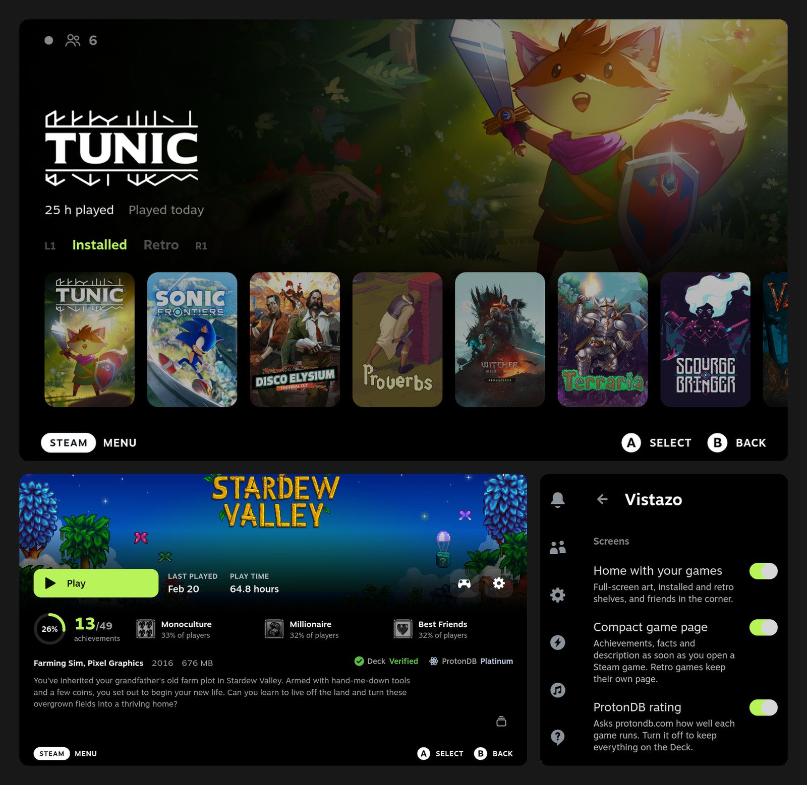

# Vistazo

**Vistazo** is a dark, opinionated [Decky Loader](https://decky.xyz) plugin for the Steam Deck: a home built on
shelves, every game page at a glance, and soft menu sounds.

[Leer en español](README.es.md)



## Home

The selected game fills the screen with its art. Your games sit below on shelves: installed, retro and any of
your Steam collections. L1 and R1 move between them, A plays, X opens the game page, Y the full library.

## Game page

Achievements, facts and the Deck and ProtonDB verdicts on the first screen, no tabs. Press A on the
achievements for the full list.

## Sounds

Every menu sound becomes a short, soft tone, made by the plugin and played through Steam's own output.

## Settings

Quick access menu → Decky → Vistazo. Turn each part on or off, swap A and X, and pick your shelves. Changes
apply at once.

## Install

1. Decky → gear icon → General → turn on Developer mode.
2. Developer → Install plugin from URL:

   ```
   https://github.com/m4rz3r0/vistazo-decky/releases/latest/download/Vistazo.zip
   ```

3. Confirm. The new home appears the next time you go Home.

Repeat step 2 to update. Uninstall from Decky → gear icon → Plugins.

## Privacy

Everything comes from Steam on the Deck. The ProtonDB rating asks `protondb.com` with the game's number only,
and can be turned off. No telemetry.

## Build

```bash
pnpm install && ./pack.sh    # out/Vistazo.zip
```

BSD 3-Clause. The build bundles `@decky/ui` and `@decky/api` (LGPL-2.1).
